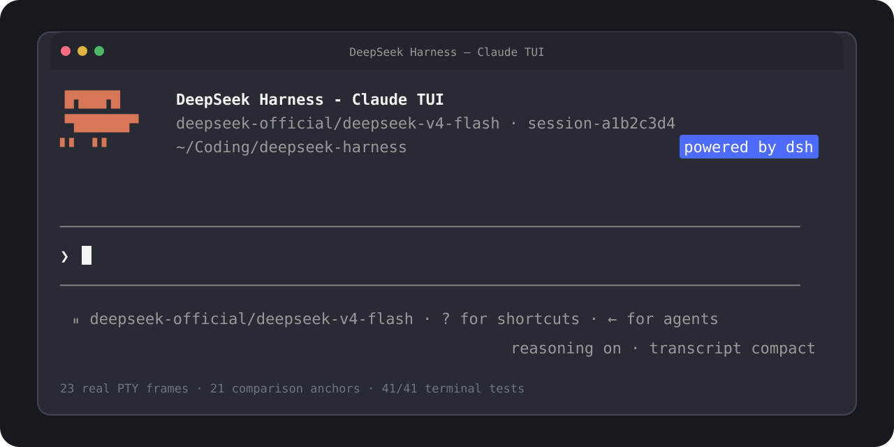

<h1 align="center">DSH Claude TUI</h1>

<p align="center"><strong>A Claude Code-style terminal workflow, powered by DeepSeek Harness.</strong></p>

<p align="center">English · <a href="./README.zh-CN.md">简体中文</a></p>

<p align="center">
  Start in one command. Use real DSH models, Sessions, tools, approvals, and subagents<br />
  through a familiar, high-fidelity terminal interface.
</p>

<p align="center">
  <a href="https://github.com/cogine-ai/dsh-claude-tui/stargazers"></a>
  <a href="https://github.com/cogine-ai/dsh-claude-tui/actions/workflows/ci.yml"></a>
  <a href="https://www.npmjs.com/package/dsh-claude-tui"></a>
  <a href="./LICENSE"></a>
  
  
</p>

<p align="center">
  
</p>

> [!NOTE]
> This is an independent community project. It is not affiliated with, endorsed by, or sponsored by Anthropic or DeepSeek. “Claude Code” identifies the version-pinned interaction target; no Anthropic source code is included. See the [trademark and compatibility notice](./DISCLAIMER.md).

## Start in one command

Version `0.1.9` uses DSH `0.2.1-rc.2` and requires Node.js **22.19+ in 22.x, or 24.2+** (`^22.19.0 || >=24.2.0`). Unsupported Node versions fail before changing your DSH Home.

```bash
npx --yes --legacy-peer-deps dsh-claude-tui@0.1.9
```

Use this command to install and open TUI `0.1.9`. You do not need a global `dsh`, a repository checkout, pnpm, or manual profile setup.

The `legacy-peer-deps` flag avoids npm's expensive resolution of unused upstream Web UI peers. It skips peer-conflict enforcement; the package explicitly includes the required TUI services and pins its DSH dependencies. The installed-package gate checks the complete `npm ls --all` tree and rejects missing, invalid, or conflicting dependencies. Ordinary npm peer resolution was also qualified for `0.1.9`, though a cold installation can take several minutes. The flag does not change the DSH runtime version or TUI behavior.

A real model request needs credentials for the DSH provider you select. Use `/provider` to inspect or enter credentials and `/model` (or `Option+P` / `Alt+P`) to switch among the models and effort levels exposed by DSH.

For repeat use:

```bash
npm install --global --legacy-peer-deps dsh-claude-tui@0.1.9
dshtui
```

The global install exposes both `dshtui` and the canonical `dsh-claude-tui` command. Resume work with `dshtui --resume` for the Session picker, or `--resume <session-id>` for an exact Session.

## DSH 0.2.1-rc.2 adaptation

Version `0.1.9` pins Harness `0.2.1-rc.2` at upstream commit `687f282e8625c6b8d11ff58211a90524be2e4317`. External runtimes must satisfy `>=0.2.1-rc.2 <0.2.2` and pass the behavioral probe. The [adaptation record](./docs/harness-0.2.1-rc.2-adaptation.md) records verification; the [release notes](./docs/releases/v0.1.9.md) describe the upgrade. Publication and registry identity are verified separately through the [v0.1.9 Release](https://github.com/cogine-ai/dsh-claude-tui/releases/tag/v0.1.9) and npm metadata.

- Tools use `native` or `ptc`. `DSH_TOOLS_MODE=both` now fails with an actionable error before discovery, probes, or DSH Home changes; `code` remains an alias for `ptc`.
- Subagents use DSH's managed activations and parent completion notices. An activation receipt means Started; the final child answer appears when its completion notice arrives. The old foreground/Job result variants and standalone in-process driver are removed.
- Working-directory changes use DSH's persisted directory service. File mentions follow that current directory; the original Session project remains unchanged. The removed `{{cwd}}` prompt variable is no longer used.
- Stored API keys now take precedence over environment fallbacks in this interactive profile. `/provider` reads DSH's reported source and writability; the upstream headless profile has different authentication defaults.
- Live replies, completed replies, usage, timing, image attachments, model selection, settings refresh, and V4 Session replay retain their DSH-owned interfaces.
- The Claude Code `2.1.227` reference layout, colors, keyboard controls, approvals, questions, image composer, plan toggle, and Session picker are retained.
- On macOS, file watchers default to one-second polling to avoid native shutdown hangs while preserving live skill, settings, and profile updates. Explicit `CHOKIDAR_USEPOLLING` / `CHOKIDAR_INTERVAL` values take precedence.
- The official MCP client now supplies the `2.2.0` client dependency, replacing the old MCP security repack. The LibreOffice `fflate` repack remains necessary.
- The [official bilingual documentation mirror](./docs/upstream/dsh/README.md) contains 2,083 original files from the same exact release. The mirror is excluded from npm packages; its index records the source inventory.

To run from a checkout:

```bash
corepack pnpm install --frozen-lockfile
corepack pnpm build
DSH_HOME=/tmp/dsh-claude-tui-0.2.1-rc.2 DSH_CLAUDE_TUI_RUNTIME=bundled node lib/cli.js
```

> [!WARNING]
> DSH continues to store V4 Sessions. Supported older logs migrate to new files while preserving the originals. The unchanged V4 version does not establish downgrade support for new events or plugin records. Use separate Homes for cross-version testing. The optional SQLite Session backend was removed in `0.1.2`; export those older Sessions with their original runtime first. SQLite query/index storage is a separate service.

See the [official 0.2.1-rc.2 release notes](https://github.com/deepseek-ai/deepseek-harness/releases/tag/dsh-v0.2.1-rc.2). The [0.2.0 adaptation](./docs/harness-0.2.0-rc.2-adaptation.md) and [v0.1.8 security release](./docs/releases/v0.1.8.md) remain historical records for that earlier version. Upstream Web, Desktop, and optional-plugin features do not imply corresponding TUI interfaces.

## What you get

| Area | User-facing behavior |
| --- | --- |
| Familiar terminal | Claude-shaped welcome panel, prompt, menus, transcript, status rows, approvals, questions, and Agent states |
| Real Harness runtime | DSH-owned models, durable Sessions, commands, approval policies, tools, structured questions, and subagents |
| Live model setup | Provider/model catalog, advertised effort levels, saved defaults, masked API-key entry, and credential-source visibility |
| Productive prompting | Multiline editing, image paste, submit or steer, cancellation, history search, slash completion, and bounded `@` file mentions |
| Clear execution | Reasoning and tool activity, compact/expanded results, cache hit rate, token totals, TTFT, throughput, and turn outcome |
| Session and Agent flow | New or resumed Sessions, graceful flush, managed subagent activations, completion notices, and an active-agent roster |
| Verified runtime identity | Welcome panel shows the actual TUI/Harness version, bundled or system runtime, DSH Home, and tool mode |

The TUI reads capabilities from DSH rather than hardcoding model, effort, credential, or approval behavior. Harness remains the source of truth; Claude-only cloud services, account state, model behavior, and private permission semantics are not simulated.

## Everyday controls

| Key or command | Action |
| --- | --- |
| `Enter` | Submit while idle or steer a running Agent |
| `Shift+Enter` | Insert a newline |
| `Ctrl+V` | Paste a clipboard image; on macOS, `Command+V` remains text paste |
| `Backspace` | Remove the last pending image when the text composer is empty |
| `Shift+Tab` | Toggle DSH plan mode for the current Session |
| `Esc` / `Ctrl+C` | Interrupt the active turn |
| `Ctrl+R` | Search prompt history |
| `Ctrl+O` | Expand or compact tool details |
| `Option+P` / `Alt+P` or `/model` | Open the live DSH model picker |
| `/provider` | Inspect or update DSH provider credentials |
| `Left Arrow` | Hide or show the active-agent roster |
| `Ctrl+D` | Press twice on an empty prompt to exit cleanly |

Run `/help` inside the TUI for the current command list.

## Works with an existing DSH setup

The default launcher removes the need to choose an installation strategy up front:

1. Reuse a compatible DSH already associated with the selected `$DSH_HOME`, or a verifiable `dsh` on `PATH`.
2. Probe it in an isolated, credential-free temporary Home.
3. Fall back to the bundled, shrinkwrap-pinned DSH `0.2.1-rc.2` when no external runtime qualifies.

Compatibility requires both the version range `>=0.2.1-rc.2 <0.2.2` and a successful behavioral probe. When a Home can be shared safely, existing credentials, Sessions, settings, and unrelated profiles remain available. The launcher does not overwrite an unowned profile. An unsafe implicit default can fall back to `~/.dsh-claude-tui` with a visible notice; an explicit `DSH_HOME` conflict fails with an actionable error instead of silently moving data.

| Variable | Behavior |
| --- | --- |
| `DSH_CLAUDE_TUI_RUNTIME=auto` | Default: try compatible system DSH, then bundled DSH |
| `DSH_CLAUDE_TUI_RUNTIME=system` | Require a compatible external DSH |
| `DSH_CLAUDE_TUI_RUNTIME=bundled` | Always use the packaged DSH |
| `DSH_HOME=/path` | Use an explicit DSH data Home |
| `DSH_TOOLS_MODE=native\|ptc` | DSH tool presentation shown as Standard or PTC; `code` aliases PTC, `both` is rejected |

See [Launcher environment compatibility](./docs/launcher-environment-compatibility.md) for the complete selection, ownership, and recovery contract.

## Compatibility and verification

The main interaction target is the observed Claude Code `2.1.227` TUI; the `[Image #1]` Ctrl+V composer behavior was independently observed against Claude Code `2.1.237`. The existing corpus contains **24** independently captured PTY reference frames and **22** automated visual/semantic anchors. Version `0.1.9` reuses this baseline. On macOS arm64, the complete Node `24.16.0` check and the fresh-cache ordinary npm peer-resolution bundle gate on Node `22.23.3` passed before PR review. Review then found a subagent roster-label ordering issue; the fix passed 64 focused application tests and typecheck. Current review and [CI results](https://github.com/cogine-ai/dsh-claude-tui/pull/24/checks) are tracked on [PR #24](https://github.com/cogine-ai/dsh-claude-tui/pull/24); exact local results and limits belong to the [adaptation record](./docs/harness-0.2.1-rc.2-adaptation.md).

- Gates exercise true-color, xterm-compatible `80x24` and `100x30` layouts, images, command attachments, approvals, questions, plan-mode keys, managed subagents, and directory changes.
- Installed-artifact gates exercise fresh npm installation, both command names, bundled and separate-runtime probes, local Messages/Files and MCP servers, sandboxed Node PTC, graceful exit and resume, and V0/V3-to-V4 migration with original-file preservation. These local servers do not qualify production-provider behavior.
- Earlier macOS counts and Ubuntu [run 38099441670](https://github.com/cogine-ai/dsh-claude-tui/actions/runs/38099441670) qualify the historical `0.2.0-rc.2` adaptation only. See the current verification table for checks and remaining platform limits.

The Windows launcher, junction, signal-forwarding, VT-input, dependency-prebuild, and STA image-clipboard paths are implemented, and the pinned DSH upstream has a native Windows gate. This TUI's own CI still runs only on Ubuntu, however, and no Windows packed-TUI/ConPTY UAT has been recorded. Windows is therefore an implemented but currently unqualified target, not a supported release platform. Read the [full visual and semantic qualification report](./docs/visual-qualification-2.1.227.md) or the [artifact-hardening baseline](./docs/release-hardening-v0.1.0.md).

## Build it with us

This project should be more than a theme layered over a runtime. The goal is a fast, inspectable terminal client that respects DSH semantics and gives developers a great place to improve the Harness experience together.

You do not need to know the entire runtime to contribute. Useful entry points include:

| Contribution lane | A good first contribution |
| --- | --- |
| Terminal qualification | Reproduce a layout or keybinding issue in a named terminal, OS, and geometry |
| Runtime integration | Add a focused test for one DSH command, Session, approval, or subagent boundary |
| Interaction design | Improve image composition, richer references, completion, or Session management without hiding unsupported states |
| Reliability | Reduce startup ambiguity, strengthen packed-install coverage, or turn a field failure into a deterministic fixture |
| Docs and language | Improve setup guidance, explain an architecture boundary, or keep English and Chinese docs in sync |
| Accessibility | Improve color fallback, keyboard-only flow, screen-reader output, or narrow-terminal behavior |

Start with the [contribution guide](./CONTRIBUTING.md), then open a [focused issue](https://github.com/cogine-ai/dsh-claude-tui/issues/new/choose) or pull request. For a larger change, propose the user problem and evidence first so maintainers and contributors can shape the seam together.

## Develop locally

```bash
corepack pnpm install --frozen-lockfile
corepack pnpm check
```

The release gate runs TypeScript validation, a clean production build, then the complete serial Vitest suite. Visual-parity changes must include an independently captured reference or a documented Harness-semantic boundary. Runtime changes must prove the installed package path, not only source imports.

Near-term opportunities include richer image composition, file and Session reference completion, broader Session management, more plan/todo/background-job states, and qualification across more terminals and operating systems. These are contribution directions, not claims about shipped behavior.

## License

Original project code is available under the [MIT License](./LICENSE). Product names and marks remain the property of their respective owners; the MIT License does not grant rights to third-party trademarks.
