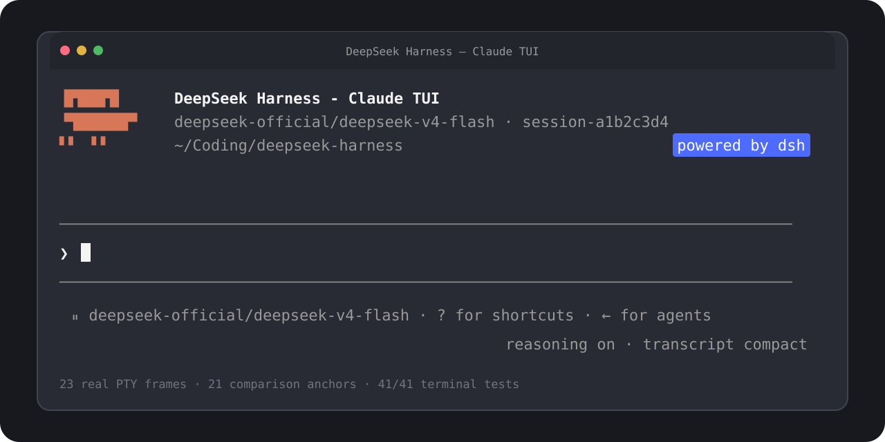

<h1 align="center">DSH Claude TUI</h1>

<p align="center"><strong>熟悉的 Claude Code 风格终端，真实的 DeepSeek Harness 能力。</strong></p>

<p align="center"><a href="./README.md">English</a> · 简体中文</p>

<p align="center">
  一条命令启动。通过高保真终端界面，直接使用 DSH 的模型、Session、工具、审批与子代理。
</p>

<p align="center">
  <a href="https://github.com/cogine-ai/dsh-claude-tui/stargazers"></a>
  <a href="https://github.com/cogine-ai/dsh-claude-tui/actions/workflows/ci.yml"></a>
  <a href="https://www.npmjs.com/package/dsh-claude-tui"></a>
  <a href="./LICENSE"></a>
  
  
</p>

<p align="center">
  
</p>

> [!NOTE]
> 这是独立社区项目，与 Anthropic 或 DeepSeek 没有隶属、背书或赞助关系。“Claude Code”仅用于标识固定版本的交互目标；仓库不包含 Anthropic 源代码。详见[商标与兼容性声明](./DISCLAIMER.md)。

## 运行本次适配

`0.1.10` 使用 DSH `0.2.2-rc.1`，需要 Node.js **24.9+**（`>=24.9.0`）。不支持的 Node 版本会在修改 DSH Home 前被拒绝。

```bash
corepack pnpm install --frozen-lockfile
corepack pnpm build
node lib/cli.js
```

`0.1.10` 目前是本地适配版，可按上方命令从本次适配工作区运行；npm 已发布版仍为 `0.1.9`。

`legacy-peer-deps` 用于避免 npm 花费大量时间求解本 TUI 不使用的上游 Web UI peer。它会跳过 peer 冲突校验；安装包显式包含必需的 TUI 服务，并固定 DSH 依赖。安装包验证会检查完整的 `npm ls --all` 依赖树，拒绝 missing、invalid 或冲突依赖。`0.1.10` 也通过了普通 npm peer 求解验证，但冷安装可能需要数分钟。该参数不改变 DSH 运行版本或 TUI 行为。

真实模型请求需要所选 DSH Provider 的凭据。使用 `/provider` 查看或录入凭据，使用 `/model`（或 `Option+P` / `Alt+P`）切换 DSH 提供的模型与 effort。

如果会反复使用：

```bash
corepack pnpm run pack:artifact
npm install --global --legacy-peer-deps ./dsh-claude-tui-0.1.10.tgz
dshtui
```

全局安装会同时提供短命令 `dshtui` 和正式命令 `dsh-claude-tui`。使用 `dshtui --resume` 打开 Session 选择器，或用 `--resume <session-id>` 精确恢复。

## 适配 DSH 0.2.2-rc.1

开发版 `0.1.10` 固定 Harness `0.2.2-rc.1`，对应上游提交 `66491b05e3f05ad35bcdd4f6cd7ed26041d9e3db`，需要 Node.js **24.9+**。外部运行时须满足 `>=0.2.2-rc.1 <0.2.3` 并通过行为探针。详见[适配记录](./docs/harness-0.2.2-rc.1-adaptation.md)和[未发布说明](./docs/releases/v0.1.10.zh-CN.md)。本次工作区尚未发布 `0.1.10`。

- Native/PTC 改由上游独立执行器插件提供。TUI 保留 `DSH_TOOLS_MODE=native|ptc`，`code` 仍为 PTC 别名；启动器会在发现运行时或写入 Home 前拒绝 `both`。直接启动 profile 时也使用同一校验，执行器选择会去除首尾空白。
- 模型选择改用 `agent.model.current()` / `select()`，立即持久化，尚未发起请求的选择也可恢复。恢复默认保留会话选择，仅显式指定模型时覆盖；已准备的步骤及重试保留已捕获的模型。
- Cordis、Loader、Group 和 Schemastery 跟随目标版本；Session 投影使用归属服务及其激活生命周期。
- [官方双语文档镜像](./docs/upstream/dsh/README.md)包含精确发布版本的 2,373 份原文件，不进入 npm 安装包。

构建后可在独立 Home 启动：

```bash
DSH_HOME=/tmp/dsh-claude-tui-0.2.2-rc.1 DSH_CLAUDE_TUI_RUNTIME=bundled node lib/cli.js
```

DSH 继续使用 V4 Session。受支持的旧格式迁移保留原件；新增事件及独立 fork 可能不兼容旧 V4 读取器，跨版本测试请使用独立 Home。可选 SQLite Session 后端已在 `0.1.2` 移除，旧会话需先用原运行时导出；SQLite 查询和索引存储是另一项服务。

完整变化见[官方发布说明](https://github.com/deepseek-ai/deepseek-harness/releases/tag/dsh-v0.2.2-rc.1)。上游 Web、Desktop、工作树及可选插件功能需要各自的界面或组合，不代表本 TUI 自动提供对应入口。

## 你能获得什么

| 方面 | 用户可见能力 |
| --- | --- |
| 熟悉的终端 | Claude 风格欢迎面板、输入框、菜单、对话记录、状态栏、审批、问题和 Agent 状态 |
| 真实 Harness | DSH 管理的模型、持久化 Session、命令、审批策略、工具、结构化问题与子代理 |
| 实时模型配置 | Provider/model 列表、DSH 暴露的 effort 级别、默认值保存、API Key 掩码录入和凭据来源 |
| 高效输入 | 多行编辑、图片粘贴、提交或 steer、中断、历史搜索、斜杠补全和有边界的 `@` 文件补全 |
| 清晰的执行状态 | reasoning、工具调用/结果、缓存命中率、Token、TTFT、吞吐率和 turn 结果 |
| Session 与 Agent | 新建/恢复 Session、安全 flush、托管子代理 activation、完成通知和活动 Agent roster |
| 可验证运行环境 | 欢迎面板显示真实 TUI/Harness 版本、system/bundled 来源、DSH Home 与工具模式 |

TUI 从 DSH 读取能力，不写死模型、effort、凭据或审批行为。Harness 是运行能力的事实来源；项目不会模拟 Claude 私有的云服务、账号状态、模型行为或权限语义。

## 常用操作

| 按键或命令 | 作用 |
| --- | --- |
| `Enter` | 空闲时提交，运行时 steer |
| `Shift+Enter` | 换行 |
| `Ctrl+V` | 粘贴剪贴板图片；macOS 上 `Command+V` 仍粘贴文本 |
| `Backspace` | 文字输入为空时删除最后一张待发图片 |
| `Shift+Tab` | 切换当前 Session 的 DSH plan mode |
| `Esc` / `Ctrl+C` | 中断当前 turn |
| `Ctrl+R` | 搜索历史 prompt |
| `Ctrl+O` | 展开或收起工具详情 |
| `Option+P` / `Alt+P` 或 `/model` | 打开 DSH 实时模型选择器 |
| `/provider` | 查看或更新 DSH Provider 凭据 |
| `Left Arrow` | 显示或隐藏活动 Agent roster |
| `Ctrl+D` | 空输入时连续按两次，安全退出 |

在 TUI 中运行 `/help` 可查看当前命令列表。

## 兼容已有 DSH 环境

默认启动逻辑让用户无需预先选择安装策略：

1. 优先复用所选 `$DSH_HOME` 已关联的兼容 DSH，或 `PATH` 中来源可验证的 `dsh`；
2. 在不继承凭据的临时 Home 中执行兼容探针；
3. 没有外部候选通过时，自动使用包内由 shrinkwrap 固定的 DSH `0.2.2-rc.1`。

外部版本须满足 `>=0.2.2-rc.1 <0.2.3`、实际依赖方解析到的 MCP client/core `>=2.3.0 <3`、undici `>=8.12.2 <9`、Zod `>=4.6.6 <5`，并通过行为探针。外部依赖不满足时，自动模式退回修复后的内置运行时；显式 system 模式会说明原因。Home 可安全共享时，已有凭据、Session、设置和无关 profile 会继续可用。启动器不会覆盖不属于自己的 profile；隐式默认 Home 不安全时可退回 `~/.dsh-claude-tui` 并显示提示，显式 `DSH_HOME` 冲突则给出可操作错误，不会偷偷移动数据。

| 变量 | 行为 |
| --- | --- |
| `DSH_CLAUDE_TUI_RUNTIME=auto` | 默认：先尝试兼容的系统 DSH，再使用包内 DSH |
| `DSH_CLAUDE_TUI_RUNTIME=system` | 必须使用兼容的外部 DSH |
| `DSH_CLAUDE_TUI_RUNTIME=bundled` | 始终使用包内 DSH |
| `DSH_HOME=/path` | 指定 DSH 数据 Home |
| `DSH_TOOLS_MODE=native\|ptc` | DSH 工具呈现模式，对应 Standard、PTC；`code` 是 PTC 别名，`both` 会被拒绝 |

完整选择、所有权和恢复规则见[启动器环境兼容说明](./docs/launcher-environment-compatibility.md)。

## 兼容与验证

原始交互基线是已观测的 Claude Code `2.1.227` TUI；`Ctrl+V` 后出现 `[Image #1]` 的输入器行为另行实测自 `2.1.237`。24 个原始 PTY 帧保持不变。`0.1.10` 新增本机 Claude Code `2.1.311` 的 9 个独立参考帧，其中 4 个用于外壳、命令菜单、完整回复和结构化问答的自动比较。旧参考集保留 21 个活动锚点，旧命令菜单帧转为历史参考。实际覆盖和限制见[体验验证与前后对比](./docs/ux-validation-0.1.10.md)及 [DSH 适配记录](./docs/harness-0.2.2-rc.1-adaptation.md)。

- 门禁包含 true-color、xterm-compatible 的 `80x24`、`100x30` 布局、图片与命令附件、审批、问题、计划模式按键、托管子代理及目录变化。
- 安装产物门禁包含全新 npm 安装、两个命令入口、包内与独立外部运行时探针、本地 Messages/Files 与 MCP 服务、受沙箱约束的 Node PTC、安全退出与恢复，以及 V0/V3-to-V4 迁移和原件保留。本地服务不构成生产 Provider 验收。
- 旧 macOS 通过数及 Ubuntu [run 38099441670](https://github.com/cogine-ai/dsh-claude-tui/actions/runs/38099441670)仅属于历史 `0.2.0-rc.2` 适配；本轮检查及平台资格边界以新适配记录的验证表为准。

Windows 启动、junction、信号转发、VT 输入、依赖预编译件和 STA 图片剪贴板路径均已实现，固定的 DSH 上游也有原生 Windows gate。但本 TUI 自己的 CI 仍只运行 Ubuntu，尚无 Windows packed-TUI/ConPTY UAT。因此 Windows 目前只是“已有实现但尚未认证”的目标，不能称为当前版本支持的发布平台。详见[完整视觉与语义资格报告](./docs/visual-qualification-2.1.227.md)和[制品加固基线](./docs/release-hardening-v0.1.0.md)。

## 一起把它做得更好

这个项目不应只是覆盖在运行时上的一层主题。我们的目标是做一个快速、可审查、尊重 DSH 语义的终端客户端，也让开发者能在这里共同改善 Harness 的使用体验。

参与不要求先读懂整个运行时，可以从这些入口开始：

| 参与方向 | 适合第一份贡献的任务 |
| --- | --- |
| 终端资格验证 | 在明确的终端、系统和窗口尺寸下复现布局或快捷键问题 |
| 运行时集成 | 为某个 DSH 命令、Session、审批或子代理边界补一项聚焦测试 |
| 交互设计 | 在不掩盖未支持状态的前提下，改善图片输入、引用、补全或 Session 管理 |
| 稳定性 | 减少启动歧义、强化安装包验证，或把现场问题变成确定性 fixture |
| 文档与语言 | 改善上手说明、解释架构边界，或保持中英文文档同步 |
| 无障碍 | 改善无颜色模式、纯键盘流程、读屏输出或窄终端表现 |

先阅读[贡献指南](./CONTRIBUTING.zh-CN.md)，然后提交一个[边界清晰的 issue](https://github.com/cogine-ai/dsh-claude-tui/issues/new/choose) 或 pull request。较大的改动请先说明用户问题和证据，让维护者与贡献者一起确定合适的实现边界。

## 本地开发

```bash
corepack pnpm install --frozen-lockfile
corepack pnpm check
```

发布门禁依次执行 TypeScript 检查、干净的生产构建和完整串行 Vitest。视觉一致性修改必须附独立捕获的参考证据，或明确记录 Harness 语义边界；运行时修改必须验证安装包路径，不能只证明源码 import 可用。

近期可参与方向包括更丰富的图片输入、文件与 Session 引用补全、更完整的 Session 管理、更多 plan/todo/后台任务状态，以及更多终端和操作系统资格验证。这些是贡献方向，不代表功能已经交付。

## License

项目原创代码采用 [MIT License](./LICENSE)。产品名称与商标归各自权利人所有；MIT License 不授予任何第三方商标使用权。
