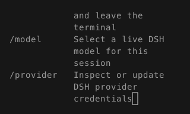
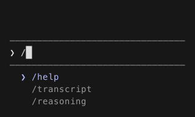
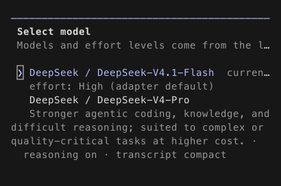
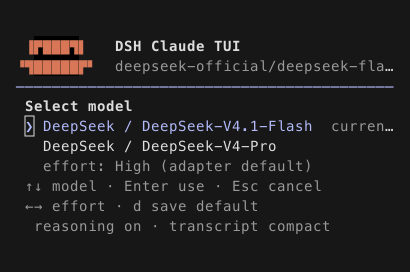
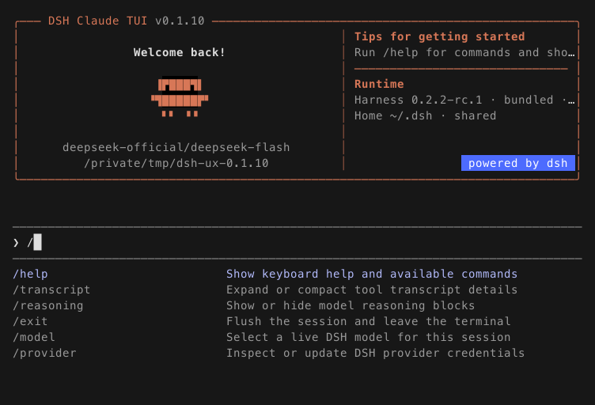
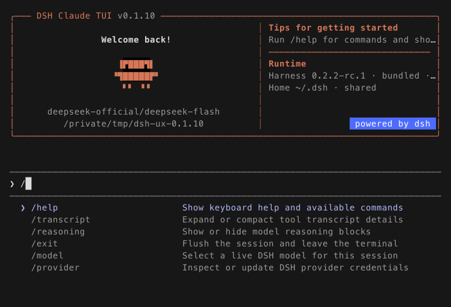
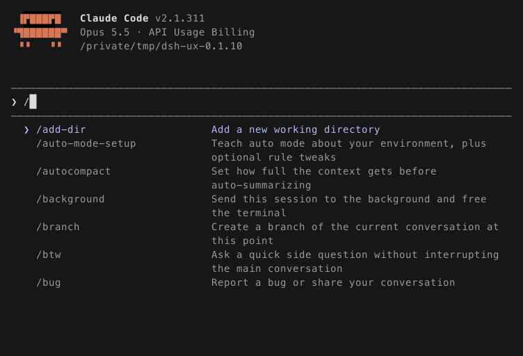
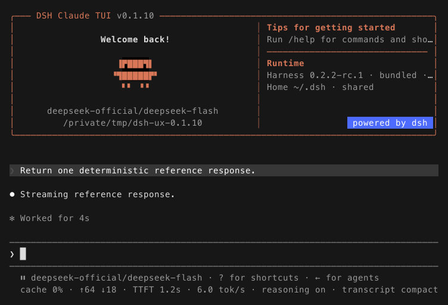
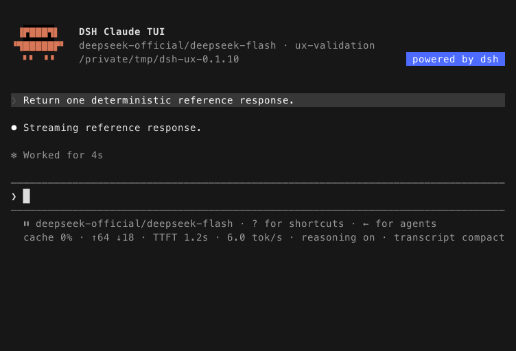

# 0.1.10 使用验证与体验修复

> 本报告记录 2026-11-05 的发布前验证。后续发布状态见 [0.1.10 发布说明](./releases/v0.1.10.zh-CN.md)。

2026-11-05，macOS arm64。基于已合并的 PR #26（`f7d08bdc0669ef798585dc4aa69a045c92701cbf`），在 `cliq/dsh-0.1.10-ux-validation` 验证并修复。DSH 固定为 `0.2.2-rc.1`，本机 Claude Code 参考为实际安装的 `2.1.311`，不声称它是上游最新版本。本轮没有发布、打标签或修改真实 DSH Home。

原则是让当前操作、选中对象和下一步保持可见，同时尽量接近 Claude Code 已观测的交互。核心本地链路和受控 API 链路可用；真实线上模型服务、原生终端的输入法组合态及其他操作系统不在本轮已通过范围内。

## 验证证据与结果

| 检查 | 证据与结果 |
| --- | --- |
| 完整检查 | Node `24.22.1`，`pnpm check`：18 个文件、273 项测试全部通过，无跳过；含类型检查、生产构建及 2,373 个上游文档文件校验 |
| 最低 Node | Node `24.9.0`：app、session-picker、clipboard、model-selection 四组，共 99 项通过 |
| 安装产物 | 完整检查使用普通 npm peer 解析，在新 consumer 目录安装；复用 npm 缓存，不能算新冷缓存认证。验证安装树、生产依赖审计、打包内容和真实 PTY 启动 |
| 安全回归 | 完整检查包含 MCP client/core、undici、Zod 修复验证及不安全外部 DSH 的拒绝/回退；生产依赖审计通过 |
| 真实 DSH PTY | 隔离 HOME / DSH_HOME、合成工作区、本地 Messages SSE 服务；修复后采集 14 个状态，覆盖欢迎、中文草稿、多行粘贴、命令导航、模型菜单、缩放、流式/完整回复、历史搜索、文件提示、帮助 |
| 键盘与窗口 | 实际 pi-tui 渲染器 + xterm ANSI 模拟器：`100×30`、`80×24`、`42×12`、`32×8`；检查光标、选中项、提交对象和取消行为。不是所有弹窗在所有尺寸的完整交叉矩阵 |
| 模型与 Provider | 模型/effort 选择、保存默认值、精确路由、拓扑变化、会话恢复；首次配置、取消、只读凭据及脱敏错误回归通过 |
| 工具与会话 | 安装产物的 PTC 工具执行与结果回传、原生子代理和结算、继续/恢复会话、历史格式、计划模式持久化、正常退出回归通过；模型输出来自本地受控服务 |
| 图片 | 开启真实 macOS 剪贴板测试：Ctrl+V → 图片标记 → 保存附件 → Files API → Messages → 回复。原剪贴板先完整备份，finally 恢复；测试结束清理备份 |
| 中文与 emoji | 多行 bracketed paste 经 `80→32→42→100` 列缩放后提交，逐字验证原始消息内容；不是原生中文输入法候选窗/组合态验证 |

完整检查执行时设置 `DSH_CLAUDE_TUI_INSTALL_MODE=default`、`DSH_CLAUDE_TUI_SYSTEM_CLIPBOARD_TEST=1` 及保留的 `DSH_CLAUDE_TUI_NPM_CACHE`。普通 CI 不会自动开启系统剪贴板测试。

原始运行日志保留在本机验证目录，不随安装包发布：`full-check-final.log`、`min-node-ux.log`、`dsh-final-reviewed.log`。下面图片均由真实 PTY 的 ANSI 单元格数据重建，不是设计建议图或原生 Terminal 截屏。重建统一使用深色背景、Menlo/PingFang TC 字体回退；单元格位置和颜色来自捕获数据，字体栅格、emoji 外观及默认背景不作为跨终端一致性承诺。每张 DSH 图片旁有同名 JSON 可复核。发布前已在不含用户名的 `/tmp/dsh-ux-0.1.10` 工作区重采前后证据；旧侧由 PR #26 的原代码构建，新侧包含本轮修复，原始帧和 PNG 同步更新。

## 发现与已完成修复

### 1. 菜单与弹窗溢出，键盘可以选到屏幕外的对象

原命令菜单只画前六项，会话列表只画第一页，但上下键可以继续选择后面的对象。短窗口下，命令描述换行把输入框挤出视口；模型说明把 effort、取消提示挤掉，审批和问答也有相同的裁切问题。根因见 `src/surface.ts`、`src/model-picker.ts`、`src/session-picker.ts`、`src/dialogs.ts`。

同为 `32×8`、输入 `/`，修复前连输入框都不可见，修复后保留输入框、当前项和有限数量的建议：

| 修复前，真实 PTY 重建 | 修复后，真实 PTY 重建 |
| --- | --- |
|  |  |

同为 `42×12`、打开 `/model`，修复后模型、effort、使用/取消及保存默认值提示都能看到：

| 修复前，真实 PTY 重建 | 修复后，真实 PTY 重建 |
| --- | --- |
|  |  |

已实施：列表视窗跟随选择；命令描述超出预算时压为单行，32 列优先保留完整命令名；短窗口模型菜单、会话列表、审批及单/多选问答保留操作所需内容。普通窗口的既有审批、问答布局仍走原参考比较。

已执行验收：选中第七条命令后，屏幕显示该命令，Enter 执行同一条；恢复第十一条会话时标题与光标都可见，返回准确 Session ID；短窗口切换到后面的模型/答案后，提交结果与屏幕一致；审批 Yes/No 均可见，拒绝返回 `rejected`；多选滚动保留先前勾选；超长插件描述不再吞掉输入框。

### 2. 命令选中态只依赖颜色，与新版 Claude Code 的明确箭头有差距

旧界面在彩色终端用颜色区分选中项。旧源码的无颜色路径没有额外选中标记，因此不能靠字形辨认当前命令；这是源码确认的问题。新版 Claude Code `2.1.311` 的真实 PTY 已使用 `❯`，提供了可以直接复核的改法。

| DSH 修复前，真实 PTY 重建 | DSH 修复后，真实 PTY 重建 |
| --- | --- |
|  |  |

本机 Claude Code `2.1.311` 的独立参考：



已实施：命令项增加明确箭头，缩进、描述列及选中颜色对齐新参考；无颜色时文件提示和多选列表也补上明确箭头。命令内容继续来自实际 DSH 能力。

已执行验收：有颜色和无颜色两条路径都能看到第七项的 `❯`，Enter 执行选中命令；新参考还检查菜单位置、描述列、颜色和输入光标。这里展示的前后图为彩色采样；无颜色结果由实际 ANSI 模拟器回归验证。

### 3. 对话开始后，欢迎面板仍长期占据 11 行

同为 `80×24`、同一条本地受控回复，旧界面持续显示完整欢迎/运行时面板，占用过多对话空间。新版 Claude Code 参考中的对话外壳更紧凑。

| 修复前，真实 PTY 重建 | 修复后，真实 PTY 重建 |
| --- | --- |
|  |  |

已实施：新会话的首个持久化用户消息到达后，欢迎面板收为紧凑头部，释放七行。初始欢迎仍展示真实 DSH 版本和来源；紧凑头部保留产品身份、模型、会话和目录。

已执行验收：欢迎阶段仍显示面板；收到持久化用户消息后面板消失、回复和后续中文草稿保留；真实 DSH PTY 流式及完整回复均重走。不会因普通提示或尚未提交的草稿提前收起。

## 图片回归中发现的测试失效

首次开启真实 macOS 剪贴板回归时失败：图片标记可见，Files 请求数为零。原因是测试仍指定旧实验路由 `deepseek-v4-flash-vision-exp`，新上游未将它声明为图片模型，会按文本能力处理。改用上游当前明确支持图片的 `deepseek-flash` 后，独立图片测试及完整 273 项测试均通过，原始 PNG 字节数、上传次数和 Messages 文件引用断言全部满足。修复的是过期回归配置，不能据此声称旧实验路由现在支持图片。

## Claude Code 对齐的范围

保留原 `2.1.227` 的 24 帧原始数据；其中 21 帧仍作活动锚点，旧 slash 帧转为历史参考。另采集 `2.1.311` 九帧，四个活动锚点是 idle（几何与调色）、slash、完整回复、结构化问答；其余五帧是观察参考。所有参考来自独立 Claude 进程，候选 UI 不生成自己的预期结果。

新参考中，审批增加了自动权限模式和第四个拒绝选项；DSH 当前没有对应的权限分类器和持久化授权语义。因此 DSH 保留实际可执行的一次允许、拒绝、取消，普通审批继续以原基线验证，不能声称整个新审批面板等价。一次将新审批整帧直接套入旧比较的检查明确失败，已改为保留这个语义边界，没有修改参考数据来掩盖差异。

新版 Claude 的文件提示选中后 Enter 路径未达到旧脚本的 `@README.zh.md` 预期，整批采样在该步骤中止；其余所列新参考随后分别捕获。DSH 文件完成路径仍有既有参考及回归，新 Claude 的该路径尚未认证。

后续更接近 Claude 的可选方向：把初始欢迎也默认收为紧凑布局，并提供独立的运行时详情入口；把常驻两行状态信息收敛为更短的状态/effort 行、按需显示统计。这两项属于后续结构调整建议，本轮没有把它们伪装成已实现或已验证功能。

## 未覆盖项与使用边界

- 未使用真实 DeepSeek 账户或线上 API，不证明线上模型路由、配额、服务波动、网络代理、真实图片理解或 OAuth/SSO 可用；本轮不读取或迁移真实账户、历史会话。
- 新修复未在 Linux/Windows 原生终端复测；此前 PR #26 的 Ubuntu CI 不能替代本轮修改后的平台验证。Windows/ConPTY 仍未认证。
- 没有原生中文输入法组合态、屏幕阅读器、浅色/高对比主题、全部 emoji 字体、tmux/远程 SSH 的完整矩阵；图片是固定深色单元格重建。
- `32×8` 验证了输入、命令、会话列表、单选与审批；模型短窗口和多选验证到 `42×12`。不承诺更小尺寸、任意长问题/工具参数或所有弹窗都能完整显示内容。
- 本报告的验证阶段尚未发布，没有做发布签名、平台安装分发或最终冷缓存发布验收；这些不能由本报告推定通过。

## 重现入口

```sh
# 普通 npm 安装路径和真实系统剪贴板；后者会备份并恢复剪贴板。
DSH_CLAUDE_TUI_INSTALL_MODE=default \
DSH_CLAUDE_TUI_SYSTEM_CLIPBOARD_TEST=1 \
corepack pnpm check

# 当前 DSH 候选的隔离真实 PTY（先 build；workspace 使用合成 Git 工作区）。
corepack pnpm build
node scripts/capture-dsh-validation.mjs /tmp/dsh-validation /tmp/synthetic-workspace

# 新版独立参考；默认版本仍为原始 2.1.227，必须显式选择新版本。
node scripts/capture-claude-reference.mjs --expected-version 2.1.311 --isolated \
  --cwd /tmp/synthetic-workspace --output /tmp/claude-reference --scenario slash

# 可视化终端单元格，而非生成假想界面。
node scripts/render-terminal-frame.mjs /tmp/dsh-validation/slash-80x24.json
```
